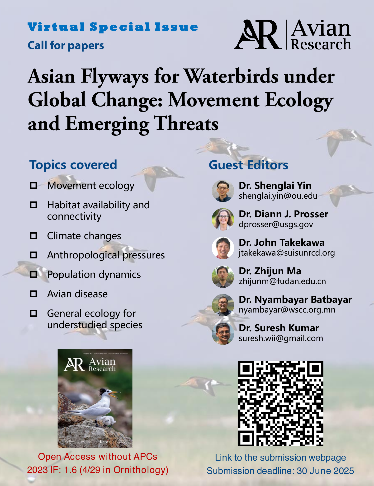

<!-- Archival call for papers. Use the author's English copy in both language views.
     Publication date: 2025-05-01. The original flyer is preserved as a PDF. -->

::: {.post-article}

The submission has been closed.

<time datetime="2025-05-01">May 1, 2025</time>

Avian migration represents one of nature’s most spectacular phenomena, providing critical ecological services and acting as indicators of environmental change. The Central Asian Flyway (CAF) and East Asian-Australasian Flyway (EAAF) are two of the busiest migratory bird routes, supporting the seasonal movements of millions of waterbirds across a vast network of habitats. The CAF stretches from the Palearctic tundra of Siberia through Central Asia, including Mongolia, the Qinghai-Tibet Plateau, Transcaucasia, and Himalayas, extending south to the Indian subcontinent and parts of the Middle East. The EAAF spans from Siberia and Alaska through East and Southeast Asia, including China, Japan, the Korean Peninsula, and the Russian Far East, reaching as far as Australia and New Zealand. Together, these flyways each connect over 30 countries and cover critical wetlands, river basins, and coastal areas, which are the vital breeding, stopover, and wintering grounds for waterbirds.

The seasonal migrations in these flyways are fundamentally influenced by various factors, including climate and weather conditions, land cover dynamics, and anthropogenic activities, and contribute significantly to ecological processes such as pest control, nutrient cycling, and organism dispersal. However, the flyways and the migratory waterbirds within are undergoing enormous challenges. Changes in climate, habitat availability and connectivity, and human activities are altering the phenology, distribution, population dynamics, and health of the migratory bird populations. As migratory waterbirds travel across international boundaries, understanding their movements and responses to environmental change requires collaborative, cross-border research efforts that promote knowledge sharing and interdisciplinary approaches.

In this special issue, we invite contributions from the global research community to advance our understanding of waterbird migration along the CAF and EAAF. We seek original research, reviews, and perspectives that address themes such as movement ecology, habitat availability and connectivity, climate changes, anthropogenic pressures, population dynamics, avian disease, as well as general ecology for understudied species. Through this special issue, we aim to bridge dialogue and build a comprehensive knowledge base to support conservation efforts for waterbirds in the CAF and EAAF.

## Topics covered

- Movement ecology
- Habitat availability and connectivity
- Climate changes
- Anthropological pressures
- Population dynamics
- Avian disease
- General ecology for understudied species

<figure class="post-flyer">
  
</figure>

<a href="posts.html">Back to posts</a>

:::
