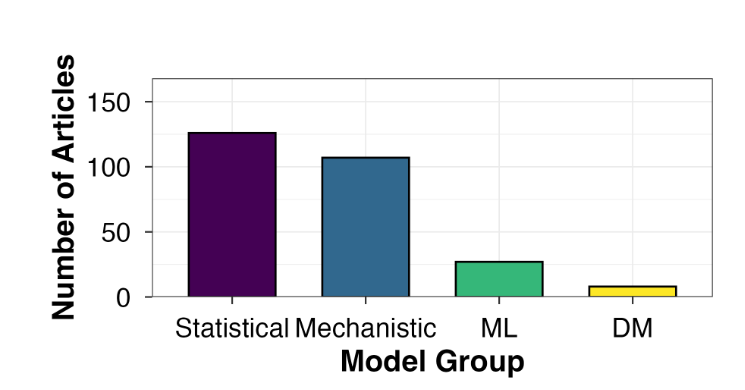
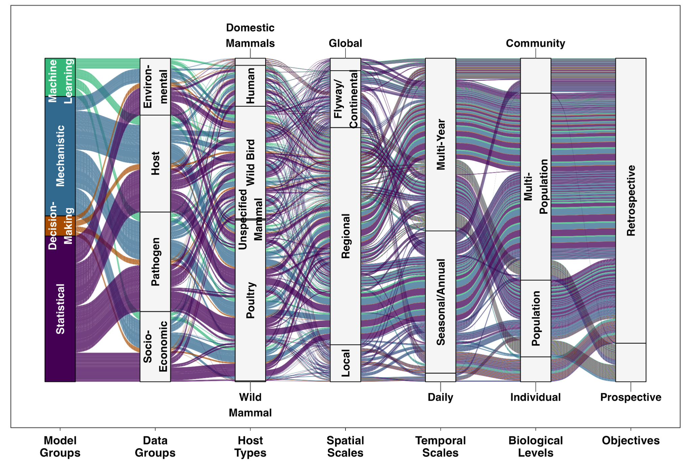

<!-- Author-supplied English and Chinese drafts are archived unchanged in
     post-drafts/avian-influenza-models/. -->

```{=html}
<div class="post-article">
<p class="post-date"><time datetime="2026-10-28">October 28, 2026</time></p>
<p id="avian-models-copy-01">How can models help us better understand avian influenza transmission and decide what to do next? Our review of 182 studies highlights opportunities to turn scientific understanding into practical decisions. These include using complementary modeling approaches, considering interacting host species, and connecting processes across space, time, and biological levels.</p>

<p id="avian-models-copy-02">Models help researchers explore how outbreaks begin, where the virus might spread, and which actions could reduce risk. They connect observations with our understanding of how viruses move among animals and through the environment. They also let us examine mechanisms and scenarios that would be difficult or impossible to test directly.</p>

<p id="avian-models-copy-03">Our systematic review covered studies published through December 2025. We examined the methods and data they used, the hosts and scales they represented, and the questions they asked. We also gathered the limitations and recommendations reported by their authors. The review covers avian influenza viruses broadly, not only highly pathogenic viruses.</p>

<h2 id="avian-models-copy-04">Different tools, different pieces of the system</h2>

<p id="avian-models-copy-05">Statistical and mechanistic models dominated the studies we reviewed. Machine learning appeared less often, and decision-making models were especially rare (Figure 1).</p>

<p id="avian-models-copy-06">Each approach has different strengths. Statistical models identify patterns in observations, while mechanistic models represent processes such as infection and recovery. Machine learning can detect complex relationships and support prediction, while decision-making models compare possible management actions. These tools can complement one another. Being less common does not, by itself, make an approach better or worse. Its value depends on the question and the available evidence.</p>

<p id="avian-models-copy-07">The limited use of decision-making models deserves particular attention. Predicting transmission is not the same as deciding what to do about it. Managers need to choose where to sample, when to intervene, and how to compare actions with different costs and consequences. <a href="https://doi.org/10.1111/cobi.14284">Decision analysis</a> can connect transmission scenarios with those choices while accounting for uncertainty and competing objectives.</p>

<p id="avian-models-copy-08">That requires researchers and decision-makers to work together from the start. What are we trying to achieve? Which actions are feasible? What evidence would prompt us to act? These questions help turn a model from an explanation of the problem into support for a practical decision.</p>

<p class="post-models-figure" id="avian-models-copy-09"><a href="assets/posts/avian-influenza-models/figure-1.png" rel="noopener noreferrer" target="_blank"></a></p>

<p class="post-models-caption" id="avian-models-copy-10"><strong>Figure 1. Different approaches with uneven use.</strong> Bars show the number of reviewed articles using each model group. An article can appear in more than one group. ML means machine learning, and DM means decision-making.</p>

<h2 id="avian-models-copy-11">Transmission is a community process</h2>

<p id="avian-models-copy-12">Most reviewed studies focused on poultry or wild birds, usually as populations or groups of populations. Communities of species sharing an environment received less attention. Yet transmission is not confined to isolated species. Birds differ in how easily they become infected, how much virus they release, where they move, and how they interact.</p>

<p id="avian-models-copy-13">Consider a wetland shared by several bird species. Knowing how many birds are present is only part of the picture. Which species are there, and how often do they encounter one another? Their differences and interactions may influence whether a virus spreads among species, persists locally, or fades out. Related research linking <a href="https://doi.org/10.1111/ele.14294">waterbird traits and community composition to infection risk</a> offers a starting point, but models are needed to examine the processes behind these associations.</p>

<p id="avian-models-copy-14">Those interactions also change with the environment. <a href="https://doi.org/10.1038/s41564-023-01538-0">Climate change can alter migration timing and species distributions</a>, while <a href="https://doi.org/10.1073/pnas.2503427122">land-use change can reshape habitats and encounters between wild birds and poultry</a>. Future models should ask not only where individual species will occur, but also which species will meet and how their interactions may affect transmission. Most reviewed studies examined past events. We also need studies that look ahead.</p>

<h2 id="avian-models-copy-15">Better data, not just more detail</h2>

<p id="avian-models-copy-16">Study authors repeatedly identified uneven surveillance and reporting, limited host data, and simplified assumptions as constraints. A map of reported infections reflects not only where infection occurs, but also where people look, which animals they sample, and whether infections are detected and reported. Few reports from an area do not necessarily mean little transmission.</p>

<p id="avian-models-copy-17">Models need to account for what surveillance misses, but they can also help improve it by identifying where, when, and which species would be most informative to sample. Better information on host behavior, immunity, movement, and community composition would also help address questions that remain difficult to answer. So would data on viral genetics and how long viruses remain infectious in the environment. The priority is not simply more data, but data that inform the processes a model is meant to explain.</p>

<h2 id="avian-models-copy-18">Across scales and levels, not maximum complexity</h2>

<p id="avian-models-copy-19">Avian influenza transmission connects processes that unfold at different scales and biological levels. Infection within one animal can influence transmission to others. Daily movements shape local encounters, while seasonal migration and trade connect distant populations. Yet existing studies concentrated on a narrower set of hosts, scales, and objectives (Figure 2). Studying each process separately can miss how changes at one scale affect another.</p>

<p class="post-models-figure" id="avian-models-copy-20"><a href="assets/posts/avian-influenza-models/figure-2.png" rel="noopener noreferrer" target="_blank"></a></p>

<p class="post-models-caption" id="avian-models-copy-21"><strong>Figure 2. How modeling approaches, data, and study designs appear together.</strong> Read from left to right to follow combinations used in the reviewed literature. Wider bands indicate combinations found in more articles. One article can contribute to several combinations. Common combinations involve bird hosts, regional spatial scales, seasonal to multi-year time scales, and studies of past transmission.</p>

<p id="avian-models-copy-22">One option is an integrated model that connects several scales and biological levels. An individual-based model, for example, represents animals separately. It can follow a host's movements, contacts, and infection state over days, then connect those local processes to seasonal migration and spread among regions. This helps researchers examine how individual encounters contribute to wider patterns.</p>

<p id="avian-models-copy-23">Another option is to build simpler models that pass information to one another. A statistical model might estimate transmission rates from observations. A mechanistic model could use those estimates to explore spread under different conditions. A decision-making model could then compare management actions using the results. These modules need a shared question, compatible spatial and temporal scales and biological levels, and clear definitions of the information exchanged.</p>

<p id="avian-models-copy-24">Neither approach is automatically preferable. An integrated model needs evidence for both its individual processes and the larger patterns it aims to explain. Linked modules also need evidence for the connections between them. Not every question requires a cross-scale model, and adding unsupported detail can increase uncertainty rather than understanding.</p>

<p id="avian-models-copy-25">The aim is to connect the scales and biological levels that matter, from individual animals to interacting communities and from local encounters to wider spread. Better avian influenza models should help us understand those connections, anticipate change, and compare practical actions, not simply become more complicated.</p>

<p id="avian-models-copy-26"><em>Related study. <a href="https://doi.org/10.1111/2041-210x.70445">A systematic review of avian influenza virus transmission models: Gaps and opportunities</a>. DOI: <a href="https://doi.org/10.1111/2041-210x.70445">10.1111/2041-210x.70445</a>.</em></p>

<p class="post-back"><a href="posts.html">Back to posts</a></p>
</div>
```
