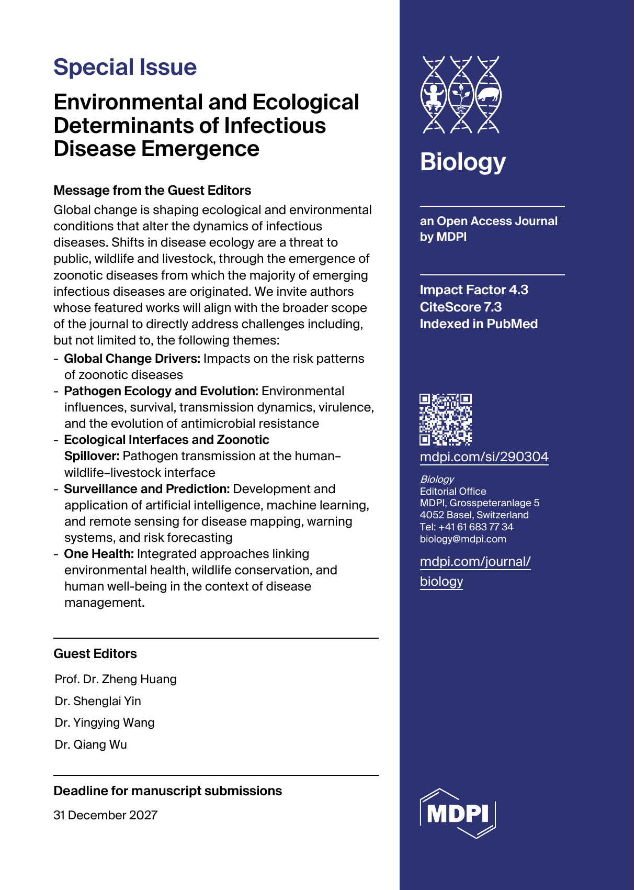

<!-- Both language views use this English copy. The supplied flyer is preserved unchanged. -->

::: {.post-article}

<time datetime="2026-10-20">October 20, 2026</time>

How do changing environments shape the emergence of infectious diseases? We are sharing a call for papers for a <a href="https://www.mdpi.com/journal/biology/special_issues/KHM9LG9485#info" target="_blank" rel="noopener noreferrer"><em>Biology</em> special issue</a> on environmental and ecological determinants of disease emergence. The issue welcomes work connecting global change, pathogen ecology, zoonotic spillover, and One Health, including research that uses new tools to improve surveillance and prediction.

<strong>Manuscript submission deadline: December 31, 2027.</strong> Please check the <a href="https://www.mdpi.com/journal/biology/special_issues/KHM9LG9485#info" target="_blank" rel="noopener noreferrer">official special issue page</a> for current submission details.

## Topics covered {#disease-emergence-topics}

- Global change drivers and zoonotic disease risk
- Pathogen ecology and evolution, including environmental survival, transmission, virulence, and antimicrobial resistance
- Ecological interfaces and spillover among humans, wildlife, and livestock
- Surveillance and prediction using artificial intelligence, machine learning, and remote sensing
- One Health approaches linking environmental health, wildlife conservation, and human well-being

## Guest editors {#disease-emergence-editors}

Prof. Dr. Zheng Huang; Dr. Shenglai Yin; Dr. Yingying Wang; Dr. Qiang Wu.

<figure class="post-flyer">
  
</figure>

<a href="posts.html">Back to posts</a>

:::
